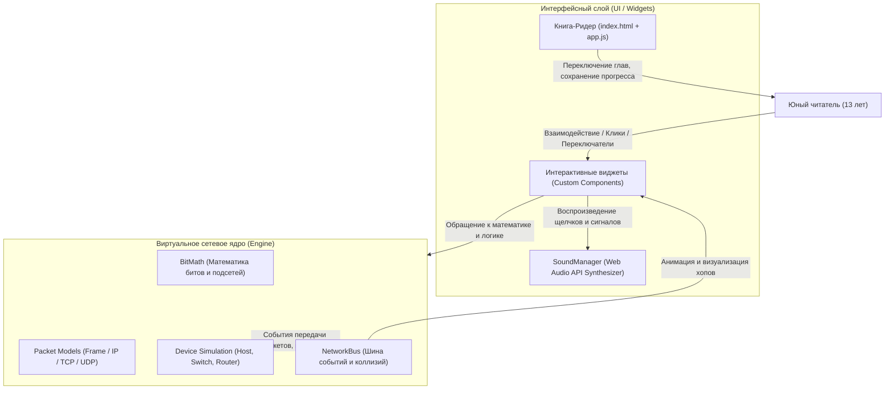

# ARCHITECTURE.md — Архитектурный атлас проекта

В данном документе описана модульная архитектура интерактивной книги, зоны ответственности компонентов и потоки данных в виртуальном сетевом стеке.

---

## 1. Дерево модулей и каталогов

```
network-foundations/
├── AGENTS.md                  # Машинно-читаемый контекст проекта и инварианты
├── README.md                  # Главная витрина проекта для человека
├── CHANGELOG.md               # Журнал версий (SemVer)
├── ARCHITECTURE.md            # Архитектурный атлас
├── build.ps1                  # Скрипт верификации и сборки (UTF-8 BOM)
├── package.json               # Манифест проекта и тестовые скрипты
├── index.html                 # Единая точка входа книги (HTML-оболочка, сайдбар, ридер)
├── css/
│   ├── book-theme.css         # Оформление книги, темы (Dark/Light), адаптивная верстка
│   └── interactive-lab.css    # Стили для интерактивных виджетов, пультов и схем
├── js/
│   ├── engine/                # СЕТЕВОЕ ЯДРО (Virtual Network Stack)
│   │   ├── BitMath.js         # Побитовая арифметика, маски, подсети IPv4/IPv6
│   │   ├── Packet.js          # Структуры PDU: Frame, IPv4, TCP, UDP, ARP, DNS, DHCP
│   │   ├── Device.js          # Абстрактные узлы: Host, Switch, Router
│   │   └── NetworkBus.js      # Событийно-ориентированная шина передачи пакетов
│   ├── widgets/               # ИНТЕРАКТИВНЫЕ ВИДЖЕТЫ
│   │   ├── MorseTelegraphLab.js# Виртуальный телеграф Морзе и живой осциллограф
│   │   ├── BitSwitchWidget.js # 8-битный тумблер 2.0 с живой формулой и квестом
│   │   ├── HexNibblesLab.js   # Сплиттер нибблов (HEX), миксер #RRGGBB и блиц-тренажер
│   │   ├── AsciiTextEncoderLab.js# Шифратор ASCII/UTF-8, магия 5-го бита и симулятор Win-1251
│   │   ├── CableInterferenceLab.js# Симулятор сред передачи (медь, оптоволокно, Wi-Fi)
│   │   ├── TopologyLab.js     # Лаборатория топологий проводов
│   │   ├── OsiLayersExplorer.js# Интерактивный рентген 7 уровней OSI vs 4 слоя TCP/IP
│   │   ├── OsiElevatorGame.js # Аркадный сортировщик сущностей по этажам OSI
│   │   ├── EncapsulationBox.js# Матрёшка PDU 2.0 (заголовки, CRC32, бит-флип помехи)
│   │   ├── SwitchCamLab.js    # Живое обучение CAM-таблицы свича
│   │   ├── SubnetCutter.js    # Нарезка подсетей (FLSM/VLSM)
│   │   ├── RouterCompass.js   # Маршрутизатор и поиск по таблице (LPM)
│   │   ├── OspfGraphVisual.js # Граф Дейкстры и динамическая маршрутизация
│   │   ├── TcpHandshakeSim.js # Рукопожатие TCP и переповторы при потерях
│   │   ├── NetworkServicesLab.js# Симулятор служб DNS, DHCP, ARP и NAT
│   │   └── PacketTracerLite.js# Финальная интерактивная песочница
│   ├── audio/
│   │   └── SoundManager.js    # Синтезатор звуков на Web Audio API
│   └── app.js                 # Приложение: роутинг глав, сохранение прогресса в localStorage
└── test/
    └── engine.test.js         # Модульные тесты сетевого ядра
```

---

## 2. Диаграмма архитектуры и потоков данных



---

## 3. Зоны ответственности компонентов ядра

1. **`BitMath`:**
   - Преобразование чисел между 2, 10 и 16 системами счисления.
   - Вычисление масок подсетей (CIDR $\leftrightarrow$ Decimal).
   - Определение адреса сети, broadcast-адреса, диапазона доступных хостов.
   - Побитовая операция `IP & Mask` для определения принадлежности одной подсети.
2. **`Packet`:**
   - Моделирование L2/L3/L4 заголовков с валидацией полей.
   - Сериализация и эмуляция полей CRC/FCS и TTL.
3. **`Device` (Host, Switch, Router):**
   - **Host:** локальный сетевой стек, кэш ARP, шлюз по умолчанию.
   - **Switch:** порты, таблица MAC $\to$ Port с тайм-аутами устаревания записей, flooding.
   - **Router:** таблица маршрутизации, выбор пути по правилу Longest Prefix Match, декремент TTL, переписывание L2 MAC-заголовков.
4. **`SoundManager`:**
   - Синтез звуков в браузере (клик тумблера, шуршание кабеля, всплеск коллизии, сигнал успешной доставки). Zero assets.
